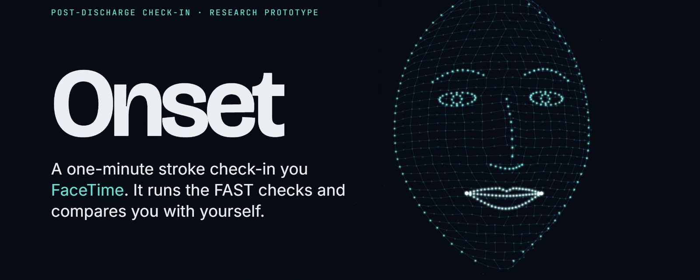
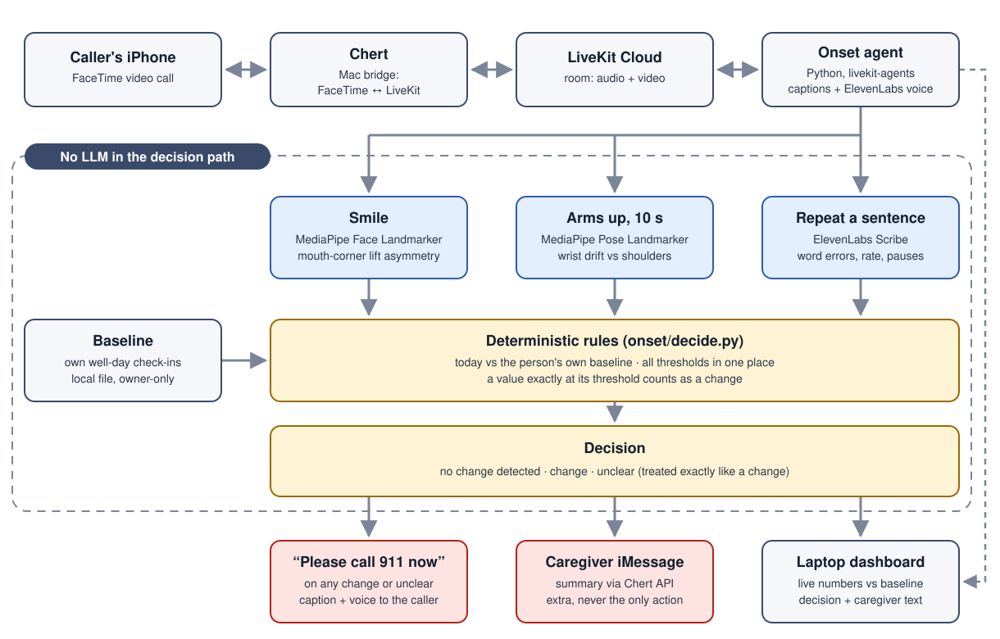
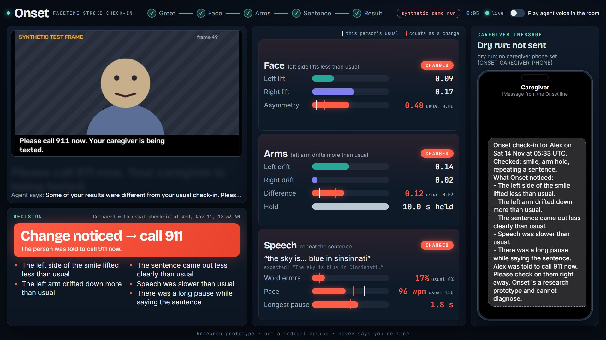
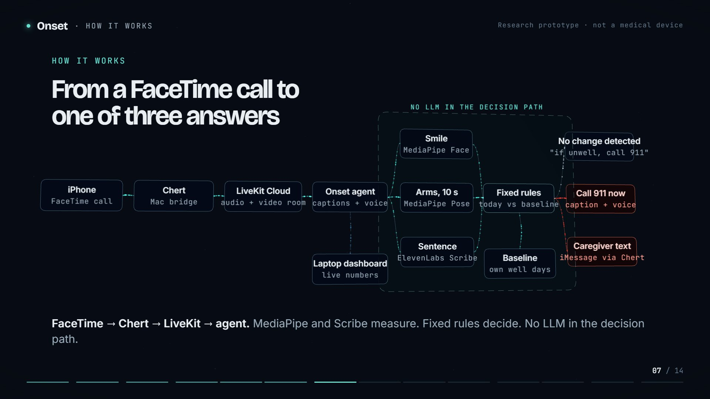

# Onset

[](https://github.com/arnavt687/onset/actions/workflows/ci.yml)




**A one-minute post-discharge stroke check-in you FaceTime.** Onset runs the checks of FAST,
the public stroke-recognition checklist (smile, both arms up for 10 seconds, repeat a sentence),
compares the numbers with the person's own well-day baseline, and if anything changed or is
unclear tells them to call 911 now and texts a caregiver.

> **Not a medical device.** Onset never says "you're fine" and never diagnoses. It is a research
> prototype and must not be relied on by patients until it has been clinically validated.

## What it is

- **Who it's for:** stroke and TIA survivors in their first 90 days home, and the family who
  does the watching. Nearly 1 in 4 US strokes are in people who had one before (CDC, *Stroke Facts*).
- **What it does:** a scripted 60-second call. Every instruction is a caption on Onset's video,
  so it works with the sound off.
- **What it never does:** say "you're fine" or name a condition.
  Anything it cannot measure clearly is treated exactly like a change.

| Outcome | What the caller sees | Caregiver |
|---|---|---|
| No change detected | "No change from your usual check-in. If you feel unwell, call 911." | not texted |
| Change | "Change noticed. Adding your caregiver to this call. Please call 911 now." | joined to the call + iMessage: what was noticed |
| Unclear | "I could not check clearly. Adding your caregiver. Please call 911 now." | joined to the call + iMessage: what could not be checked |

## How it works



- **Chert** gives the agent a real Apple line; a Mac on Chert's side bridges FaceTime into LiveKit.
- **LiveKit** carries audio and video between Chert and the agent (your own LiveKit Cloud project).
- **agent.py** is a Python LiveKit agent (`livekit-agents` 1.8). It receives the caller's camera,
  sends it back with the caption overlay (`onset/overlay.py`), and speaks with ElevenLabs
  (falls back to Gemini, then OpenAI).
- **Smile:** MediaPipe Face Landmarker, how far each mouth corner lifts (asymmetry index).
  **Arms:** MediaPipe Pose, each wrist's drift over 10 s against the shoulder line.
  **Speech:** ElevenLabs Scribe, word error rate, words per minute and the longest pause.
- **Fixed rules** in `onset/decide.py` compare today with the baseline; every threshold is in
  one dataclass and explained in [docs/thresholds.md](docs/thresholds.md).

More: [architecture](docs/demo/architecture.md) · [safety framing](docs/demo/safety.md) ·
[ROADMAP.md](ROADMAP.md) · [CHERT_SUPPORT_REPORT.md](CHERT_SUPPORT_REPORT.md) (the open audio
issue on Chert's side).

| The caller's captions (640×360) | The laptop dashboard | The pitch deck |
|---|---|---|
|  |  |  |

## Run it (Linux, WSL Ubuntu or macOS)

**Run it on your own Chert line: [docs/run-on-your-chert-line.md](docs/run-on-your-chert-line.md)**
(prerequisites, every `.env.local` setting, what each check means, troubleshooting).

```bash
tools/setup.sh               # Python 3.12 .venv + requirements, MediaPipe models, Node/Chert CLI, .env.local
#                              then fill in .env.local privately and run: tools/chert.sh login
tools/demo.sh --check        # tools/doctor.py: keys, voice, models, LiveKit, the line's audio_ready, clock
```

```bash
tools/demo.sh                       # checks (stops on FAIL), then agent + chert dev + dashboard
.venv/bin/python agent.py start     # or by hand, terminal 1: the agent
tools/chert.sh dev                  # terminal 2: connects it to the Chert line
tools/stop.sh                       # stops both (Ctrl+C releases the line)
```

The dashboard is at http://localhost:8765 (`tools/dashboard.py`); the pitch deck, with a
browser demo of the three measurements, is `tools/pitch.sh` → http://localhost:8770
([web/pitch/README.md](web/pitch/README.md)).

## Test without FaceTime

```bash
.venv/bin/python -m pytest -q tests                    # the suite CI runs
.venv/bin/python selftest.py                           # offline video pipeline check
.venv/bin/python tools/fake_call.py                    # plays Chert's part in a private LiveKit room
.venv/bin/python tools/demo_events.py --outcome escalate   # a synthetic run for the dashboard
.venv/bin/python tools/render_captions.py              # every caption as the caller sees it
```

Built with ElevenLabs, LiveKit and Chert.
