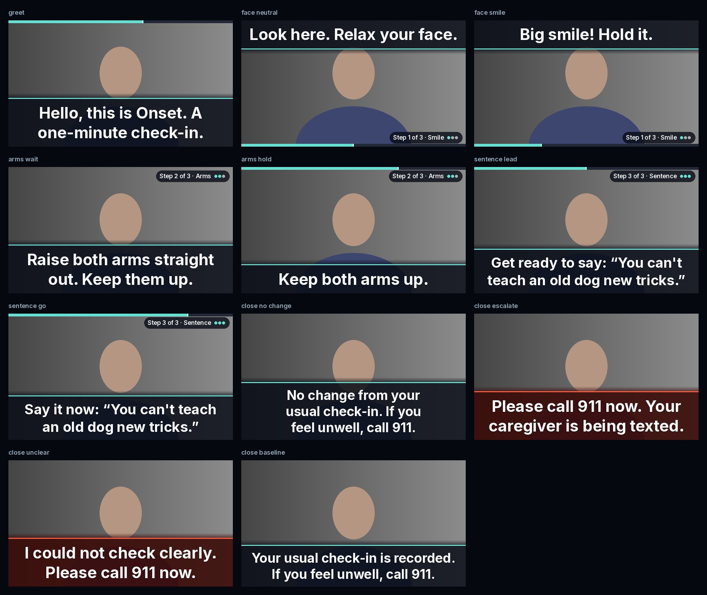

# Onset

[](https://github.com/arnavt687/onset/actions/workflows/ci.yml)


**A one-minute post-discharge stroke check-in you FaceTime.** Onset runs the checks of FAST,
the public stroke-recognition checklist (smile, both arms up for 10 seconds, repeat a sentence),
compares the numbers with the person's own well-day baseline, and if anything changed or is
unclear tells them to call 911 now and texts a caregiver.

> **Not a medical device.** Onset never says "you're fine" and never diagnoses. It is a research
> prototype and must not be relied on by patients until it has been clinically validated.

## What it is

- **Who it's for:** stroke and TIA survivors in their first 90 days home, and the family who
  does the watching. Nearly 1 in 4 US strokes are in people who had one before (CDC, *Stroke Facts*).
- **What it does:** a scripted 60-second call. Every instruction is a caption on Onset's video,
  so it works with the sound off.
- **What it never does:** say "you're fine" or name a condition.
  Anything it cannot measure clearly is treated exactly like a change.

| Outcome | What the caller sees | Caregiver |
|---|---|---|
| No change detected | "No change from your usual check-in. If you feel unwell, call 911." | not texted |
| Change | "Change noticed. Adding your caregiver to this call. Please call 911 now." | joined to the call + iMessage: what was noticed |
| Unclear | "I could not check clearly. Adding your caregiver. Please call 911 now." | joined to the call + iMessage: what could not be checked |

If the camera cannot see the face or both arms, Onset first says how to fix the picture
("I can't see your left hand. Move back so both hands show.") and runs that step again, up to
twice. Only if it still cannot see them is the result Unclear. An arm that drops or is never
raised is a finding, never a reason to retry ([details](docs/thresholds.md#framing-retries)).

## How it works


- **Chert** gives the agent a real Apple line; a Mac on Chert's side bridges FaceTime into LiveKit.
- **LiveKit** carries audio and video between Chert and the agent (your own LiveKit Cloud project).
- **agent.py** is a Python LiveKit agent (`livekit-agents` 1.8). It receives the caller's camera,
  sends it back with the caption overlay (`onset/overlay.py`), and speaks with ElevenLabs
  (falls back to Gemini, then OpenAI).
- **Smile:** MediaPipe Face Landmarker, how far each mouth corner lifts (asymmetry index).
  **Arms:** MediaPipe Pose, each wrist's drift over 10 s against the shoulder line.
  **Speech:** ElevenLabs Scribe, word error rate, words per minute and the longest pause.
- **Fixed rules** in `onset/decide.py` compare today with the baseline; every threshold is in
  one dataclass and explained in [docs/thresholds.md](docs/thresholds.md).

More: [architecture](docs/demo/architecture.md) · [safety framing](docs/demo/safety.md) ·
[ROADMAP.md](ROADMAP.md) · [CHERT_SUPPORT_REPORT.md](CHERT_SUPPORT_REPORT.md) (the open audio
issue on Chert's side).

| The caller's captions (640×360) | The laptop dashboard | The pitch deck |
|---|---|---|
|  |  |  |

## Run it (WSL Ubuntu)

```bash
cd ~/onset
~/.venvs/uv/bin/uv venv --python 3.12 .venv
~/.venvs/uv/bin/uv pip install --python .venv/bin/python -r requirements.txt
cp .env.example .env.local   # then fill in your keys privately
tools/setup-shared.sh        # MediaPipe models into ~/onset/models
```

```bash
tools/demo.sh                       # demo day: checks, then agent + chert dev + dashboard
.venv/bin/python agent.py start     # or by hand, terminal 1: the agent
tools/chert.sh dev                  # terminal 2: connects it to the Chert line
tools/stop.sh                       # stops both (Ctrl+C releases the line)
```

The dashboard is at http://localhost:8765 (`tools/dashboard.py`); the pitch deck, with a
browser demo of the three measurements, is `tools/pitch.sh` → http://localhost:8770
([web/pitch/README.md](web/pitch/README.md)).

## Longitudinal tracking

Every check-in is archived on this machine when the call ends (`onset/events.py`):
`runs/<run_id>/events.jsonl` holds each step's metrics and the decision, next to the last
annotated frame and the agent's spoken lines. The caller's own video and audio are kept
only with `ONSET_RECORD=1` (`recordings/<run_id>/`). `runs/`, `recordings/` and `baselines/`
are gitignored and never leave the machine.

`onset/history.py` reads those archives after the fact (nothing in the call flow changes) and
lines up one person's check-ins over a rolling 90-day window from the first one:

- per check-in: date, outcome, smile asymmetry, arm drift left / right / difference, word error
  rate, words per minute, longest pause, and any step that was not measured cleanly;
- per measurement: least-squares slope, change against the baseline, last 7 days against the
  7 days before, and how many check-ins reached the change threshold from `onset/decide.py`;
- a **gradual decline** flag when a measurement moves steadily toward its threshold although
  no single check-in reached it (rules in [docs/thresholds.md](docs/thresholds.md#longitudinal-trends)).

Unreadable or unfinished archives are skipped and counted, never fatal.

```bash
.venv/bin/python tools/demo_history.py                                  # 14 synthetic daily check-ins
.venv/bin/python tools/history_report.py --patient demo-patient --out history.html   # care-team summary
.venv/bin/python tools/history_report.py --patient demo-patient --json  # the same as JSON
```

The report is one self-contained HTML file (owner-only on disk): a plain-language summary,
the trend flags, a sparkline per measurement with its baseline and threshold, and a table of
check-ins. It describes measurements only and never names a condition. The dashboard's
**Trend** button shows the same sparklines for the person on the current call (or open it
with `?patient=<id>&trend=1`), from `GET /api/history?patient=<id>`. Sending the report to a
care team is not automated yet.

## Test without FaceTime

```bash
.venv/bin/python -m pytest -q tests                    # the suite CI runs
.venv/bin/python selftest.py                           # offline video pipeline check
.venv/bin/python tools/fake_call.py                    # plays Chert's part in a private LiveKit room
.venv/bin/python tools/demo_events.py --outcome escalate   # a synthetic run for the dashboard
.venv/bin/python tools/render_captions.py              # every caption as the caller sees it
```

Built with ElevenLabs, LiveKit and Chert.
