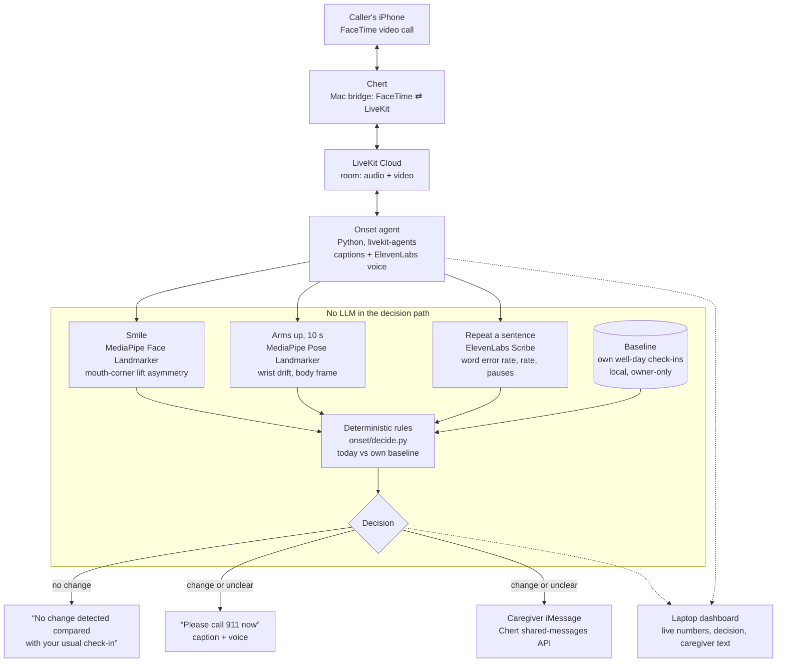

# Onset: architecture

Slide version: [`architecture.svg`](architecture.svg) (same diagram, readable on light and
dark backgrounds).

## How a check-in flows

1. **The call.** The person FaceTimes Onset's number. Chert owns the Apple line; a Mac on
   Chert's side answers and bridges the call into a LiveKit Cloud room. `chert dev`, running
   next to the agent, connects that room to our agent.
2. **The agent** (`agent.py`, Python on `livekit-agents` 1.8) receives the caller's camera and
   microphone, and publishes one video track back: the caller's own picture with captions,
   countdowns and landmarks drawn on it. It speaks with ElevenLabs text-to-speech. Because
   agent audio does not reach the caller over FaceTime yet, every line is also a caption.
3. **Three measurements**, each returning a value and a quality flag:
   - **Smile** (`onset/measure/face.py`): MediaPipe Face Landmarker. How far each mouth corner
     lifts from the relaxed face, in a face frame that removes head tilt and distance.
     `asymmetry = 1 − weaker lift / stronger lift`.
   - **Arms** (`onset/measure/arms.py`): MediaPipe Pose Landmarker. Each wrist's drop over the
     10-second hold, measured against the shoulder line in shoulder widths, so phone movement
     cancels. The value used is the difference between the two sides.
   - **Speech** (`onset/speech.py`): ElevenLabs Scribe transcribes the repeated sentence with
     word timestamps. Onset computes word error rate, words per minute and the longest pause.
4. **The decision** (`onset/decide.py`) compares today's numbers with the person's baseline
   (the mean of their own well-day check-ins). Any value past its threshold in the worse
   direction → change. Otherwise, any step that was not measured well, any missing value, a
   short arm hold or no valid baseline → unclear. Only when everything was measured and is
   within threshold → no change detected. Thresholds live in one dataclass and are explained
   in `docs/thresholds.md`.
5. **The action.** Change and unclear lead to the same thing: "Please call 911 now" on screen
   and in voice, and an iMessage to the caregiver through Chert (`onset/chert_api.py`). The
   text is an extra; the spoken and captioned instruction is the safety action.
6. **The dashboard** on the laptop shows the audience the caller's video with landmarks, the
   live numbers next to the baseline, the decision and the caregiver text.

## What "No LLM in the decision path" means

No general-purpose language model writes any instruction, interprets any result or makes the
decision. The script is fixed, and the decision is ordinary code: the same numbers always give
the same outcome, and each outcome comes with plain-language reasons that can be traced to a
named threshold.

The measurements do use machine-learned models: MediaPipe's landmark models, and Scribe's
speech recognition, which has its own language-model biasing (it turns mildly slurred words
back into the correct words; see `notes/speech.md`). That is why the speech check also uses
speaking rate and pauses, and why every measurement has quality gates that turn a doubtful
result into "unclear".

## Where data goes

- **Stays on the machine:** baselines (`baselines/`) and opt-in call recordings
  (`recordings/`), both gitignored, directories 0700 and files 0600.
- **Passes through services:** the call's audio and video through Chert and LiveKit Cloud;
  the sentence audio to ElevenLabs Scribe for transcription; the agent's lines to ElevenLabs
  for speech; the caregiver text through Chert.
